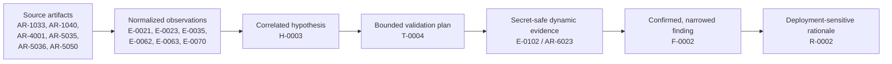

# F-0002 Evidence-to-Risk Demonstration

**Assessment:** A-C9-2016  
**Prepared:** September 10, 2026  
**Purpose:** Provide one complete, reviewable example of how the workflow moves
from heterogeneous source artifacts to a bounded risk conclusion.

## Demonstration Claim

The Archer C9 management plane transmitted repeated authentication material and
readable administrative content over cleartext HTTP during the tested trusted-
LAN management exchange. A passive or active observer already positioned on
that LAN path could observe the exchange without possessing router credentials.
The test did not decode or replay the authentication value and did not establish
account takeover, post-logout reuse, or WAN exposure.

## Chain at a Glance

**Presentation-ready figure:**
`Deliverables/00-briefing/figures/f0002_evidence_to_risk_chain_20260910.svg`

The arrows represent reviewable references, not automatic promotion. H-0003,
F-0002, and R-0002 each required a separate analyst decision.

## Stage 1 — Source Artifacts and Neutral Observations

| Domain | Source artifact | Evidence record | What the record establishes | What it does not establish |
|---|---|---|---|---|
| Firmware startup | AR-1033, `artifacts/2016/rcS.txt`, SHA-256 `55567c…e81` | E-0021 | The active firmware startup sequence invokes `/usr/bin/httpd`, directly or through `tdbrun`. | That every management exchange is cleartext or that credentials are exposed. |
| Firmware web content | AR-1040, `artifacts/2016/web_content_summary.txt`, SHA-256 `cb3bc1…d20` | E-0023 | A substantial `/web` content tree and the embedded HTTP server are present. | An explicit document-root directive or live protocol behavior. |
| Network | AR-4001, factory-default LAN Nmap output, SHA-256 `8f9ebb…8a3` | E-0035 | TCP/80 was reachable at `192.168.0.1` from the tested LAN position. | WAN reachability or authenticated behavior. |
| Protocol | AR-5035, bounded unauthenticated HTTP transcript, SHA-256 `08e348…4f3` | E-0062 | The HTTP endpoint advertised Basic authentication. | The credential representation used after login or whether it could be replayed. |
| Protocol negative limit | AR-5036, bounded HTTPS attempt, SHA-256 `15427e…3f4` | E-0063 | The tested client could not establish a TCP/443 HTTPS endpoint at that target and time. | Global absence of TLS under every configuration or interface. |
| Configuration | AR-5050, Local Management screenshot, SHA-256 `cd92fe…88a` | E-0070 | The displayed setting allowed all LAN computers to access the web utility. | Enforcement correctness or access from outside the LAN. |

These records become meaningful together: the firmware contains and starts the
management service, the physical DUT exposes it on TCP/80, the live endpoint
advertises Basic authentication, a bounded HTTPS alternative was not reached,
and the displayed local-management rule permits broad LAN access. None of these
observations alone justified a vulnerability finding.

## Stage 2 — Correlation Produces H-0003

The correlation step joined those observations under one threat context:
`TA-LAN-ONPATH`, an actor capable of observing traffic between an authorized
management browser and the DUT on the trusted Ethernet or Wi-Fi LAN.

H-0003 asked whether that actor could obtain reusable management credentials or
sensitive administrative content because the management plane used HTTP
without demonstrated HTTPS protection. At this point the statement remained a
hypothesis because the collected evidence did not yet show an authenticated
exchange. The principal gaps were:

- how authentication material appeared after login;
- whether it was transmitted repeatedly;
- whether administrative response content remained readable; and
- whether any observed value was actually reusable.

The last question was deliberately left outside the first validation boundary.

## Stage 3 — T-0004 Converts the Gap into a Safe Test

T-0004 authorized one controlled login and benign authenticated request on an
isolated, operator-controlled LAN. Its safety and evidence controls required:

- one operator-owned credential and one owned DUT;
- capture limited to the client/DUT HTTP exchange;
- no guessing, replay, interception, WAN exposure, or configuration change;
- immediate stop if capture scope expanded or a state-changing request appeared;
- restricted handling of the raw PCAP; and
- a value-suppressed derivative suitable for ordinary project evidence.

The planned support criterion was direct observation of reusable-looking Basic
authorization material or readable sensitive content on the cleartext path.
The contradiction criterion was failure to observe either within the bounded
exchange, without generalizing that negative result to every workflow.

## Stage 4 — Dynamic Evidence Returns to the Store

T-0004 completed on September 8, 2026. The secret-safe derivative AR-6023 has
SHA-256 `adfb73…552` and supports E-0102. It records:

- an 18.754775-second capture containing 877 packets;
- 54 HTTP requests and 54 HTTP responses;
- no standard HTTP `Authorization` header;
- 50 requests carrying a cookie named `Authorization`;
- the same suppressed cookie value in all 50 occurrences;
- a `Basic` prefix in all 50 occurrences; and
- 54 responses with dissector-visible content.

Cookie, form, URI, credential, and response-body values were excluded from the
normal evidence. No decoding or replay occurred. E-0102 is a neutral dynamic
observation; its `not-a-finding` tag reinforces that evidence intake did not
automatically create a security conclusion.

## Stage 5 — Analyst Adjudication Narrows the Finding

The analyst accepted promotion of H-0003 to F-0002 only after reviewing the
full chain. The finding title is:

> Web management transmits persistent authentication material and
> administrative content over cleartext HTTP.

F-0002 narrows the original hypothesis in three important ways:

1. It reports repeated authentication material, not demonstrated credential
   replay or account takeover.
2. It identifies an `Authorization` cookie with a Basic prefix, not a standard
   HTTP `Authorization` header.
3. It limits exposure to a capable observer on the tested trusted-LAN path; it
   does not assert WAN reachability.

The observed stability and repetition make the material security-relevant, but
the word *reusable* is retained only as an untested follow-on possibility.

## Stage 6 — R-0002 Adds Context Without Inflating Impact

R-0002 separates the risk components:

| Component | Accepted rationale |
|---|---|
| Attacker access | Passive or active on-path visibility between a legitimate management browser and the DUT on trusted Ethernet or Wi-Fi. The observer does not need router credentials. |
| Exploitability | Straightforward when that network position and a legitimate management session coincide because the tested channel lacks HTTPS protection. Replay and takeover were not tested. |
| Affected assets | Administrator authentication material, management-session confidentiality, and administrative response content. |
| Trust boundary | The management-channel confidentiality boundary is crossed when an uncredentialed path observer can read the exchange. |
| Demonstrated impact | Disclosure of repeated authentication material and readable administrative content. |
| Plausible but untested consequences | Credential or session reuse, configuration manipulation, DNS/routing changes, downstream traffic effects, and persistence. |

The accepted conclusion is a **high-priority, deployment-dependent management-
plane risk** and the first remediation priority among the three findings. Risk
is more plausible on shared, flat, or weakly isolated LAN/Wi-Fi networks and is
reduced—but not eliminated—by a tightly controlled management segment.

## Claim Ladder

| Level | Defensible statement |
|---|---|
| Directly observed | One stable Basic-prefixed `Authorization` cookie value appeared in 50 cleartext HTTP requests, and 54 response bodies were dissectable. |
| Corroborated context | The firmware starts an HTTP service, TCP/80 was reachable, the endpoint advertised Basic authentication, the displayed policy allowed all LAN computers, and the bounded TCP/443 attempt failed. |
| Validated finding | Authentication material and administrative content traversed the tested trusted-LAN management path without transport encryption. |
| Contextual risk | An on-path LAN observer could obtain that material during a legitimate management session; deployment topology changes the likelihood. |
| Explicitly unclaimed | Decoding, replay, account takeover, post-logout validity, WAN exposure, configuration manipulation, persistence, or a specific CVE. |

## Provenance Walk-Back

A reviewer can start at R-0002 and traverse backward without relying on prose
memory:

`R-0002 → F-0002 → H-0003 → T-0004 → E-0102 → AR-6023 → restricted raw capture`

The broader hypothesis context also resolves through E-0021, E-0023, E-0035,
E-0062, E-0063, and E-0070 to their registered source artifacts and hashes.
This bidirectional inspection path is the practical contribution of the
workflow: conclusions remain connected to both the evidence that supports them
and the limits that prevent overstatement.

## Report-Ready Summary

F-0002 demonstrates the complete evidence-to-risk lifecycle. Static firmware
analysis first identified the embedded management service, while network and
configuration observations established live TCP/80 reachability, Basic-
authentication signaling, the bounded failure to reach TCP/443, and broad
displayed LAN-management access. These records were correlated into H-0003,
not directly labeled as a finding. T-0004 then tested the missing authenticated
behavior through a bounded, secret-safe capture. E-0102 recorded one stable
Basic-prefixed authentication-cookie value on 50 cleartext requests and readable
response content without retaining credential values or performing replay.
Analyst adjudication promoted only the demonstrated portion to F-0002, and
R-0002 then treated it as the highest remediation priority under shared or
weakly isolated LAN conditions. The final claim remains explicitly bounded
away from WAN exposure, account takeover, post-logout reuse, and untested
downstream consequences.
